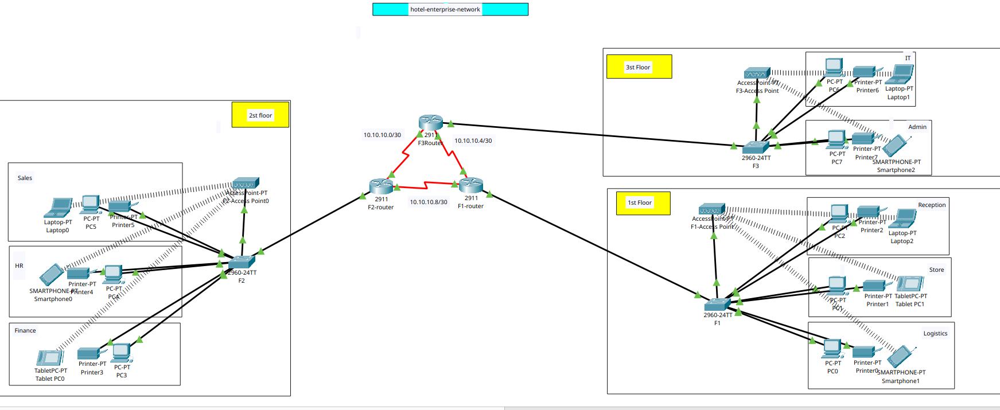

# Enterprise Hotel Network — Cisco Packet Tracer

**Three-floor hotel network simulation | Cisco IOS · OSPF · VLANs · DHCP · SSH**

## Overview

This lab models a three-floor hotel's network with eight departments. Dedicated IPv4 networks and VLANs separate broadcast domains, while three interconnected Cisco routers provide routed connectivity across floors. Wired endpoints and wireless access points model everyday hotel operations.

> **Educational simulation:** VLAN separation alone does not enforce traffic restrictions. ACLs, wireless security, and failover still require separate configuration and validation before claiming secure isolation or verified resilience.

## Network topology



## Architecture

- **Routers:** 3 Cisco 2911 (F1-Router, F2-Router, F3-Router)
- **Switches:** 3 Cisco Catalyst 2960; `Fa0/1` is an active 802.1Q trunk on each switch
- **Routing:** OSPF process 10, area 0
- **Inter-VLAN routing:** Router-on-a-Stick using `GigabitEthernet0/0` subinterfaces
- **Services:** Departmental DHCP pools; remote management through SSH (SSHv2 verified on F2 and F3)
- **Endpoints:** PCs, printers, access points and wireless clients

### Point-to-point /30 addressing

| Link | Network | Router interfaces |
|---|---|---|
| F2 ↔ F3 | `10.10.10.0/30` | F2 `S0/2/0` = `10.10.10.1`; F3 `S0/2/1` = `10.10.10.2` |
| F1 ↔ F3 | `10.10.10.4/30` | F1 `S0/2/0` = `10.10.10.5`; F3 `S0/2/0` = `10.10.10.6` |
| F1 ↔ F2 | `10.10.10.8/30` | F1 `S0/2/1` = `10.10.10.9`; F2 `S0/2/1` = `10.10.10.10` |

### VLAN plan

| Floor | Department | VLAN | Subnet | Gateway | Switch access ports |
|---|---|---:|---|---|---|
| F3 | IT | 10 | `192.168.1.0/24` | `192.168.1.1` | Fa0/2–3 |
| F3 | Admin | 20 | `192.168.2.0/24` | `192.168.2.1` | Fa0/4–6 |
| F2 | Sales | 30 | `192.168.3.0/24` | `192.168.3.1` | Fa0/6–8 |
| F2 | HR | 40 | `192.168.4.0/24` | `192.168.4.1` | Fa0/4–5 |
| F2 | Finance | 50 | `192.168.5.0/24` | `192.168.5.1` | Fa0/2–3 |
| F1 | Logistics | 60 | `192.168.6.0/24` | `192.168.6.1` | Fa0/6–8 |
| F1 | Store | 70 | `192.168.7.0/24` | `192.168.7.1` | Fa0/4–5 |
| F1 | Reception | 80 | `192.168.8.0/24` | `192.168.8.1` | Fa0/2–3 |

## Verification

| Check | Observed result |
|---|---|
| `show ip ospf neighbor` on F1 | Two adjacent routers in `FULL` state |
| `show ip route` on F1 | OSPF routes to VLANs 10–50; equal-cost routes to `10.10.10.0/30` |
| F1 → `192.168.1.1` | 5/5 pings, 23 ms average |
| F1 → `192.168.3.1` | 5/5 pings, 19 ms average |
| F1 → `192.168.5.1` | 5/5 pings, 24 ms average |
| `show interfaces trunk` on each switch | `Fa0/1` trunking with IEEE 802.1Q |
| `show ip ssh` on F2/F3 | SSH version 2.0 enabled |

These tests demonstrate routing and basic reachability. Client-to-client validation was reported during the lab but is not yet supported by saved test output. OSPF failover and subsequent route restoration were verified.

## OSPF Failover and Recovery Test

A controlled link failure was simulated on F1-Router by shutting down the direct F1–F3 serial interface `Serial0/2/0`.

| Observation | Normal operation | After link failure | After restoration |
|---|---|---|---|
| Path to IT network | F1 → F3 | F1 → F2 → F3 | F1 → F3 |
| Next hop | `10.10.10.6` | `10.10.10.10` | `10.10.10.6` |
| OSPF cost | 65 | 129 | 65 |
| ICMP to `192.168.1.1` | 5/5 successful | 5/5 successful | Not separately tested |

During failure, the F1–F3 adjacency went from FULL to DOWN. The routing table moved to the alternate next hop, and traceroute showed `10.10.10.10` followed by `10.10.10.2`. After `no shutdown`, both F1 neighbors returned to FULL and the direct route was restored. The test demonstrates reachability after convergence, not measured zero downtime or convergence duration.

## Open the lab

Download and open [`Hotel_Enterprise_Network.pkt`](Hotel_Enterprise_Network.pkt) in Cisco Packet Tracer.

Useful Cisco IOS commands:

```text
show ip interface brief
show ip ospf neighbor
show ip route
show vlan brief
show interfaces trunk
show ip ssh
```

## Next improvements

- Capture client-to-client ping/traceroute evidence and measure OSPF convergence time
- Define inter-department ACLs, wireless security policies and DNS services
- Restrict trunk allowed VLANs and document DHCP exclusions

**Project:** Personal networking portfolio lab. Addresses and sample credentials are for simulation only.
